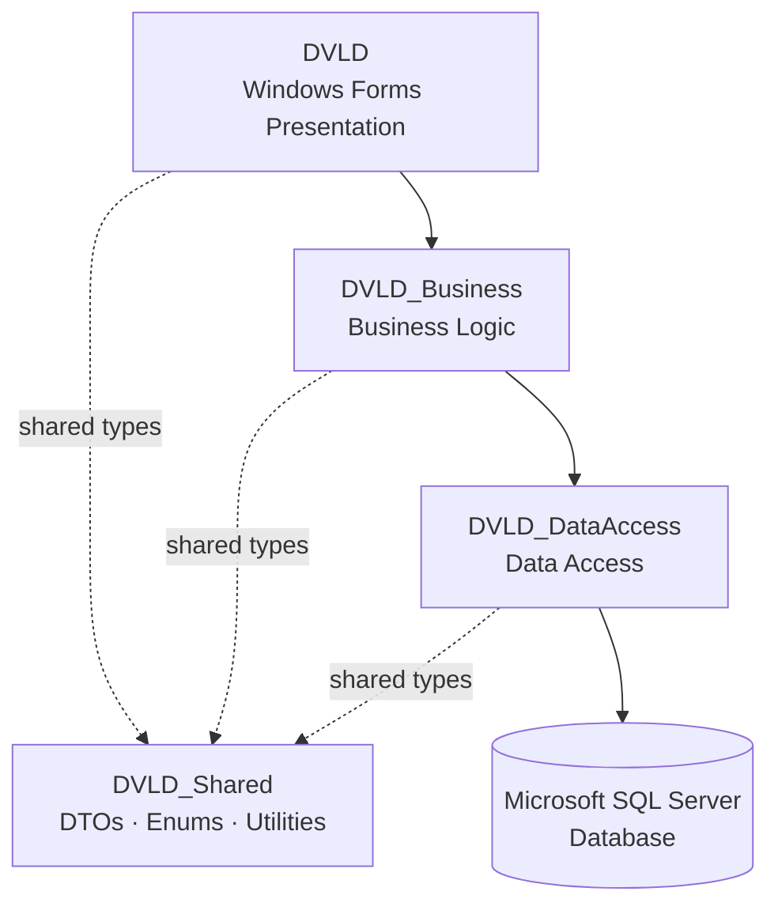
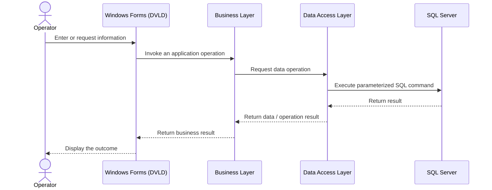

<div align="center">

# DVLD — Driving & Vehicle License Department

### A Windows desktop application for managing driving-license services and related administrative workflows.

<p>
  
  
  
  
  
</p>

</div>

---

## Table of Contents

- [Overview](#overview)
- [Features](#features)
- [Technology Stack](#technology-stack)
- [Architecture](#architecture)
- [Solution Structure](#solution-structure)
- [Application Workflows](#application-workflows)
- [Database](#database)
- [Configuration and Setup](#configuration-and-setup)
- [Build and Run](#build-and-run)
- [Screenshots](#screenshots)
- [Implementation Notes](#implementation-notes)
- [Known Setup Considerations](#known-setup-considerations)
- [Potential Future Improvements](#potential-future-improvements)
- [Acknowledgments](#acknowledgments)

---

## Overview

**DVLD (Driving & Vehicle License Department)** is a C# desktop application developed with Windows Forms and .NET Framework 4.8. It is designed to support administrative workflows related to people, users, drivers, driving-license applications, tests, license issuance, renewals, replacements, international licenses, and detained licenses.

The solution is organized into separate presentation, business-logic, data-access, and shared-component projects. This separation keeps the Windows Forms interface distinct from business operations and database communication.

> **Project scope:** This README describes the solution and implementation files supplied in the repository archive. It does not claim that every workflow has been runtime-tested, nor does it replace the database required by the application.

## Features

The following functional areas are represented by forms, business classes, and data-access components in the supplied source code.

| Area | Source-supported capabilities |
|---|---|
| People | Create, edit, find, and manage person records. |
| Users | User management, sign-in, account-related operations, and password changes. |
| Drivers | Driver records and driver listing. |
| Local driving-license applications | Create and manage local license applications and view application information. |
| Tests and appointments | Manage test types, schedule test appointments, and record test results. The project includes vision, written, and street-test workflows. |
| License issuance | Issue a local driving license after the relevant application and test workflow. |
| License renewal | Renew local driving licenses. |
| License replacement | Handle replacement requests for lost or damaged local licenses. |
| International licenses | Create and manage international-license applications and records. |
| Detained licenses | Detain licenses and process their release. |
| Application administration | Manage application types and related application information. |

Feature presence is based on the available source code. Actual behavior may depend on a correctly configured SQL Server database and has not been independently validated through an end-to-end runtime test.

## Technology Stack

| Technology | Usage |
|---|---|
| C# | Main programming language. |
| .NET Framework 4.8 | Target framework declared by the solution projects. |
| Windows Forms | Desktop user interface. |
| Microsoft SQL Server | Relational database expected by the data-access layer. |
| ADO.NET | Database access through classes such as `SqlConnection`, `SqlCommand`, and `SqlDataReader`. |
| Visual Studio | Solution and project development environment. |

The supplied project files use framework assemblies and project references. No third-party NuGet package dependency was identified during inspection.

## Architecture

The solution follows a layered organization. The primary application flow is from the Windows Forms presentation project through the business layer and into the data-access layer. Shared DTOs and utilities are referenced where needed.



### Layer responsibilities

- **Presentation — `DVLD`:** Windows Forms, screens, user interaction, and presentation-level coordination.
- **Business Logic — `DVLD_Business`:** Domain operations and application rules, exposed through business classes.
- **Data Access — `DVLD_DataAccess`:** SQL Server communication and data retrieval/persistence through ADO.NET.
- **Shared Components — `DVLD_Shared`:** Data Transfer Objects (DTOs), shared enumerations, and common utilities such as event logging.

### Project references

The project references in the supplied solution establish these dependencies:

- `DVLD` references `DVLD_Business` and `DVLD_Shared`.
- `DVLD_Business` references `DVLD_DataAccess` and `DVLD_Shared`.
- `DVLD_DataAccess` references `DVLD_Shared`.

## Solution Structure

The Visual Studio solution is `DVLD/DVLD.sln` and contains four projects:

```text
Project DVLD/
├── DVLD/
│   ├── Applications/       # License and application-related forms
│   ├── Drivers/            # Driver screens
│   ├── Main/               # Main application form
│   ├── People/              # People management screens
│   ├── Tests/               # Test types, appointments, and test screens
│   ├── Users/               # User management screens
│   ├── Config/              # Application and connection configuration files
│   ├── Resources/           # Icons and image resources
│   ├── DVLD.csproj
│   └── DVLD.sln
├── DVLD_Business/           # Business/domain classes and utilities
├── DVLD_DataAccess/         # SQL Server data-access classes
├── DVLD_DTO/                # Shared project (project name: DVLD_Shared)
└── .gitignore
```

The tree above highlights the main project areas rather than listing every form, designer file, resource, or class.

## Application Workflows

The source code supports the following high-level interaction pattern:



This diagram illustrates the architectural interaction pattern represented by the project references and data-access implementation. Individual workflows may have additional steps and validation rules.

## Database

The application expects a Microsoft SQL Server database. SQL statements and data-access classes in the source refer to database objects including:

- `People`
- `Countries`
- `Users`
- `Drivers`
- `Applications`
- `ApplicationTypes`
- `LocalDrivingLicenseApplications`
- `LicenseClasses`
- `TestAppointments`
- `TestTypes`
- `Tests`
- `Licenses`
- `InternationalLicenses`
- `DetainedLicenses`

The source also references views named `Drivers_View` and `LocalDrivingLicenseApplications_View`.

**Database schema limitation:** A database backup, schema script, or table-definition export was not included in the supplied archive. Consequently, this README does not assert primary keys, foreign keys, indexes, constraints, stored procedures, or a complete entity-relationship model. Those details should be documented only after the actual database schema is made available.

## Configuration and Setup

### Prerequisites

- Windows.
- Visual Studio with .NET desktop development tools.
- .NET Framework 4.8 Developer Pack / targeting pack.
- Microsoft SQL Server instance containing a compatible DVLD database.
- Permission for the application to connect to the SQL Server instance.

### 1. Clone the repository

```bash
git clone <YOUR-REPOSITORY-URL>
cd <YOUR-REPOSITORY-FOLDER>
```

Replace the placeholders with the URL and directory name of your repository.

### 2. Prepare the database

Create or restore the DVLD database on your SQL Server instance. The database backup or schema script is not included in the supplied project archive, so a compatible database must be obtained separately.

### 3. Configure the database connection

The data-access settings class reads a connection string named:

```text
DVLDConnectionString
```

The repository contains these configuration-related files:

- `DVLD/Config/App.config`
- `DVLD/Config/ConnectionStrings.config.example`
- `DVLD/Config/ConnectionStrings.config` (present in the supplied archive; do not publish real credentials)

Before running the application, review the configuration arrangement and correct the mismatch described in [Known Setup Considerations](#known-setup-considerations). Use your own SQL Server instance and credentials. Never commit passwords or production connection strings.

A connection string generally follows this shape; replace the placeholders locally and keep credentials out of source control:

```xml
<connectionStrings>
  <add name="DVLDConnectionString"
       connectionString="Data Source=YOUR_SERVER;Initial Catalog=DVLD;Integrated Security=True;TrustServerCertificate=True"
       providerName="System.Data.SqlClient" />
</connectionStrings>
```

This is an illustrative configuration shape, not a claim that the supplied configuration is already wired correctly. If SQL Server authentication is used instead of Windows Integrated Security, store the credentials securely and do not commit them.

### 4. Configure the people-images directory

The business settings read the `ImagesFolderPath` application setting. The supplied `App.config` currently specifies:

```text
C:\DVLD-People-Images
```

Make sure the configured directory exists or that the application can create/use it, and that the running user has the required read/write permissions.

## Build and Run

1. Open `DVLD/DVLD.sln` in Visual Studio.
2. Confirm that the .NET Framework 4.8 targeting pack is installed.
3. Review and correct the configuration files as described above.
4. Ensure that the SQL Server database is available and the connection string points to it.
5. Set the `DVLD` project as the startup project if Visual Studio has not selected it automatically.
6. Build the solution using **Build → Build Solution**.
7. Start the application using **Debug → Start Debugging** or `F5`.

The application cannot be expected to complete database-backed workflows until a compatible database and runtime configuration are in place.

## Screenshots

No application screenshots or screen recordings were included in the supplied archive. Add genuine screenshots to the repository and replace the placeholders below when available.

Suggested repository layout:

```text
docs/
└── screenshots/
    ├── login.png
    ├── dashboard.png
    ├── people-management.png
    ├── local-license-applications.png
    ├── test-appointments.png
    └── license-management.png
```

Suggested README gallery:

| Login | Main Dashboard |
|---|---|
| `docs/screenshots/login.png` | `docs/screenshots/dashboard.png` |

| People Management | License Applications |
|---|---|
| `docs/screenshots/people-management.png` | `docs/screenshots/local-license-applications.png` |

| Test Appointments | License Management |
|---|---|
| `docs/screenshots/test-appointments.png` | `docs/screenshots/license-management.png` |

> The paths above are recommendations only. They are not existing screenshot files, and the images will not render until you add the corresponding files.

## Implementation Notes

- **DTO-based data transfer:** The shared project contains DTO classes for application, person, driver, license, test, appointment, detained-license, international-license, and user data.
- **Business/data separation:** Business classes delegate persistence operations to the data-access project rather than placing SQL operations directly in the forms.
- **ADO.NET:** The data-access project uses SQL client classes for database operations. Parameterized commands are present in the inspected data-access implementation.
- **Shared enumerations:** `DVLD_Shared` includes shared enumerations used across the solution.
- **Image-path configuration:** The business layer reads `ImagesFolderPath` from application settings and includes a file helper for image-related operations.
- **Event logging:** The shared utility `clsEventLogger` provides Windows Event Log-related logging functionality.

## Known Setup Considerations

The supplied archive contains configuration details that should be reviewed before treating the repository as ready for a fresh installation:

1. **Connection-string name mismatch:** `DVLD_DataAccess/Settings/clsSettings.cs` requests `DVLDConnectionString`, while the supplied `ConnectionStrings.config.example` uses the name `DVLD_ConnectionString`. These names must match.
2. **Application configuration placement:** The application settings are in `DVLD/Config/App.config`, and the project file lists that file as a `None` item. A .NET Framework desktop application normally reads its runtime configuration from the executable's `.exe.config` file. Verify that the required settings are copied or transformed into the expected runtime configuration location as part of the build/publish process.
3. **External database dependency:** No SQL Server backup or schema script was included, so a new developer cannot recreate the database from this repository alone.
4. **Credentials:** The supplied archive includes a connection configuration file. Check the repository history as well as the current working tree for exposed credentials. If a real password or secret has ever been pushed to a remote repository, rotate it; deleting it from the latest commit does not remove it from earlier Git history.

These are observations about the supplied files and should be resolved or clearly documented before presenting the project as immediately runnable by a new contributor.

## Potential Future Improvements

The following are suggestions, not claims about existing functionality:

- Add a versioned database schema or a sanitized database setup script.
- Provide a clean, documented configuration template and keep local secrets outside version control.
- Add automated tests for business rules and data-access behavior.
- Add validation and error-handling documentation for the main workflows.
- Include genuine screenshots or short GIF recordings of representative application journeys.
- Add a reproducible setup checklist for a fresh development environment.
- Consider a migration strategy for future database schema changes.

## Acknowledgments

This project was developed as a software engineering learning project using C#, Windows Forms, .NET Framework, and SQL Server. Thanks to the educators, documentation authors, and open-source communities whose learning resources support software development.

---

<div align="center">

**DVLD — Driving & Vehicle License Department**  
*Built with C# and .NET Framework 4.8*

</div>
